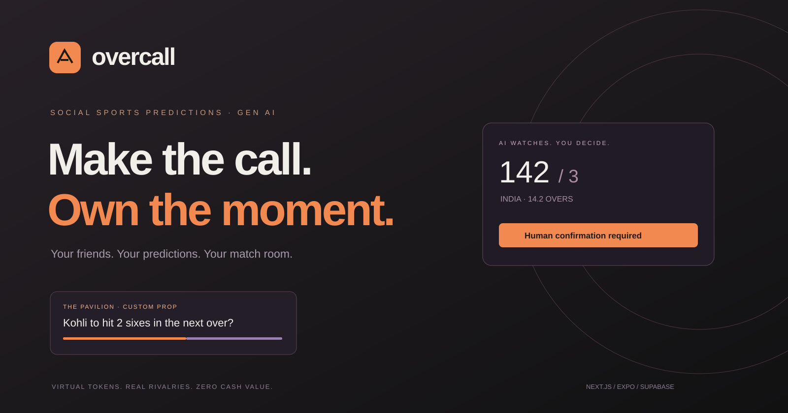
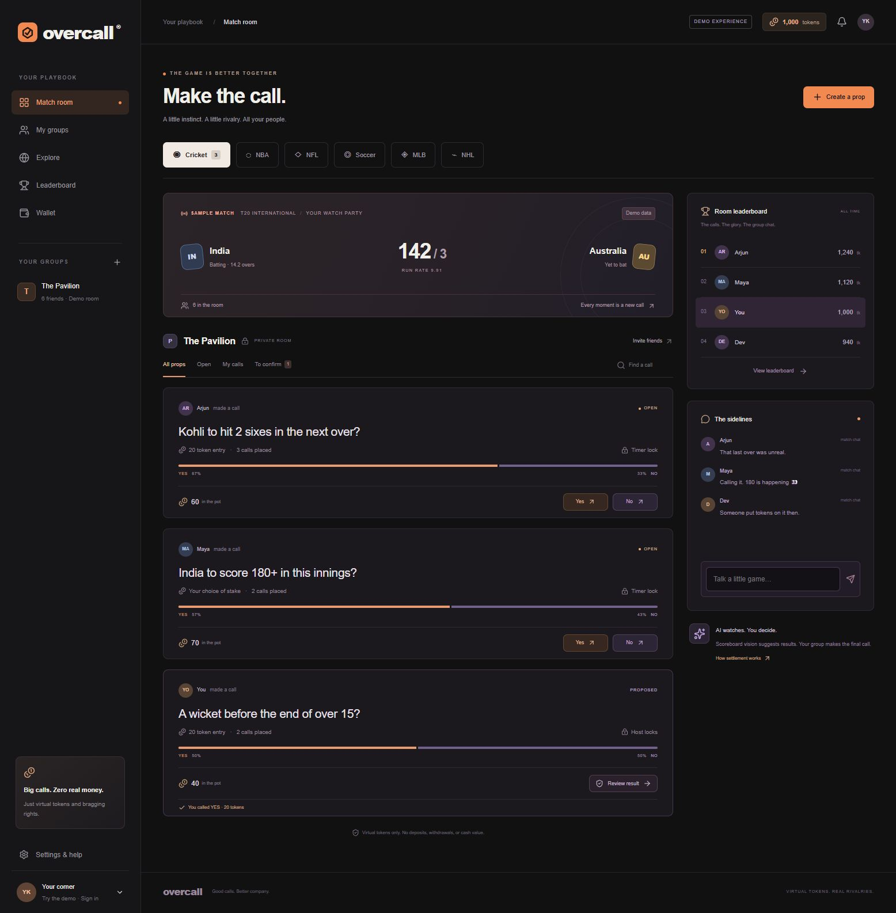

# Overcall [GenAI]

### Make the call. Own the moment.



**Overcall** is a social sports prediction app for small groups of friends. Create spontaneous Yes/No props, stake virtual tokens, talk in the match room, and compete for bragging rights. OpenRouter vision can read a shared scoreboard and suggest a result. **A human confirmation rule always comes before settlement.**

**Project type: GenAI / full-stack application.** It integrates existing multimodal foundation models through OpenRouter. It does not train a custom machine-learning (ML) or deep-learning (DL) model. Its vision provider may internally use deep learning, but this repository is an application/integration project, not an ML/DL training project.

> Virtual tokens only. No deposits, purchases, withdrawals, transfers for money, or cash redemption.

## Product preview



Charcoal surfaces, ivory text, warm orange actions, and muted violet for the opposing side. No green. A minimal original logo and straightforward responsive interface built with Next.js, React, Tailwind CSS, and local shadcn-style Radix UI components.

## What's implemented

- **Web match room:** custom props, sports filters, search, personal calls, review queue, token pool shares, chat, group standings, and wallet history.
- **Custom prop rules:** fixed, match-initiator, or chosen stake; timer/manual/event-host locks; permanent entry closure; one entry per user per prop.
- **Human settlement:** majority, initiator plus one, or admin confirmation policies; evidence proposals, accept/reject voting, deterministic proportional payouts, and full void refunds.
- **Virtual economy:** 1,000 starting tokens, 50-token daily reward, immutable client-facing transaction ledger, integer arithmetic, atomic debits/refunds/payouts, and duplicate-entry/payment constraints.
- **Supabase backend:** full schema, indexes, RLS on every application table, signup trigger, guarded RPCs, private evidence bucket, and realtime subscriptions.
- **OpenRouter vision:** authenticated Edge Function, image/JSON validation, configurable multimodal model, per-prop throttling, null-on-uncertainty extraction schema, confidence-gated proposals, and shared room scoreboard capture with periodic frames. Human evidence is an alternative.
- **WebRTC broadcasting:** one host streams a selected scoreboard to up to nine viewers, using authenticated, recipient-only Supabase signaling. TURN credentials are issued server-side when a coturn relay is configured.
- **Groups:** create private rooms, add existing accounts by ID, configurable confirmation and strict-mode settings in the group dialog and via RPC. Strict mode records missed participation rather than automatically expelling friends.
- **Community:** public text feed posting and private follow database primitives.
- **Expo native client:** email OTP, private room selection, prop cards, creation, joining, evidence proposals, votes, settlement, daily reward, secure session storage, and realtime refresh. Native vision and full feature parity remain future work.
- **Demo mode:** a clearly labeled local experience without credentials. Demo uses simulated admin confirmation; connected groups default to participant majority.

Live scoreboards cover Cricket, NBA, NFL, MLB, NHL, and Premier League soccer. Cricket uses ESPNcricinfo live-scores RSS by default, with an optional richer CricketData.org adapter. Other sports use ESPN public scoreboards. Source timestamps and stale states are visible. No Odds API is used; pool shares are calculated in-house.

## Stack

| Layer      | Technology                                                               |
| ---------- | ------------------------------------------------------------------------ |
| Web        | Next.js 16.4.5 App Router, React 19, TypeScript                          |
| UI         | Tailwind CSS 4, local shadcn-style components, Radix Dialog/Slot, Lucide |
| Mobile     | Expo SDK 58, React Native 0.88, SecureStore                              |
| Backend    | Supabase Auth, Postgres, Realtime, Storage, Deno Edge Functions          |
| GenAI      | OpenRouter multimodal Chat Completions with structured outputs           |
| Validation | Zod, TypeScript                                                          |
| Testing    | Node test runner, tsx, PGlite Postgres integration tests                 |
| CI         | GitHub Actions: tests, types, production build                           |

## Run the web app

Requires Node.js 24 and npm.

```bash
npm ci
npm run dev
```

Open [the local preview](http://127.0.0.1:3000). Without credentials, the app starts in demo mode. Demo data persists in browser local storage; Settings & help contains a reset action. No API keys are needed for the demo.

## Connect Supabase

1. Create a Supabase project or start the local Supabase stack with Docker.
2. Copy `.env.example` to `apps/web/.env.local`. Set only `NEXT_PUBLIC_SUPABASE_URL` and `NEXT_PUBLIC_SUPABASE_PUBLISHABLE_KEY` there for the web client.
3. Using a working Supabase CLI, link the selected project and apply the migration in `supabase/migrations`. Inspect `supabase db push --dry-run` before applying to any existing database.
4. Enable email sign-in and allow the actual web origin in Auth redirect URLs. For local use, allow both `http://localhost:3000` and `http://127.0.0.1:3000`.
5. Restart Next.js, sign in, create a group, and add friends who have already signed in. The signup trigger provisions each profile and starting grant.
6. Run Supabase security/performance advisors and test policies against real accounts before a production launch.

```bash
supabase login
supabase link --project-ref YOUR_PROJECT_REF
supabase db push --dry-run
supabase db push
```

The migrations are deployed to a dedicated live Overcall Supabase project. Automated PGlite tests cover the same schema, and a live Postgres rollback-only smoke check verified quorum, payouts, RLS, and private signaling. See [live setup and verification boundaries](docs/LIVE_SETUP.md).

## Configure OpenRouter vision

Set `OPENROUTER_API_KEY` and `OPENROUTER_VISION_MODEL` in **Supabase Edge Function secrets**. Choose a model that supports both image inputs and JSON-schema structured outputs. No model is hard-coded because availability and provider capabilities vary. Use the dashboard's secret editor; never put provider secrets in `NEXT_PUBLIC_*` or `EXPO_PUBLIC_*` variables.

```bash
supabase functions deploy vision --project-ref YOUR_PROJECT_REF
```

The configuration disables the gateway's legacy JWT check; the function itself explicitly verifies the bearer token with Supabase Auth before accessing any prop or calling OpenRouter. This supports modern publishable-key clients.

In a locked prop, select **Collect result evidence**, then share the scoreboard or upload a frame. A selected screen is previewed locally and sampled every 20 seconds while the dialog remains open. The AI may propose a result only when the evidence is sufficient and confidence meets the group's threshold. Humans vote, then a member explicitly settles. Vision is never the final authority.

`OPENAI_API_KEY` and `OPENAI_VISION_MODEL` are **future placeholders only**. There is no direct OpenAI adapter, fallback, or automatic use of an OpenAI credential. No real provider key is included, and no paid inference was run during development.

## Run Expo

The mobile package is intentionally installed separately to keep web-only setup small.

```bash
npm ci
cd apps/mobile
npm ci
# Copy .env.example to .env and configure the public Supabase fields.
npm start
```

Configure the Supabase email template to include the OTP token for native code verification. The native client shares `packages/core` source with web. Native build signing, simulator/device QA, screen capture, and store submission are not part of this initial release.

## Verify

```bash
npm test
npm run typecheck
npm run build
```

Tests execute the actual SQL migration and cover membership isolation, forbidden balance writes, fixed stake validation, duplicate entries, rollback on overspend, lock enforcement, quorum voting, payouts, refunds, repeated finalization, restricted AI write access, expired timers, and daily reward idempotency. Shared logic tests cover transition guards, deterministic integer payout remainders, one-sided pools, and invalid vision results.

## Repository structure

```text
apps/
  web/                    Next.js app and original visual assets
  mobile/                 Expo native client
packages/core/src/        Shared types, validation, state machine, payout math
supabase/
  migrations/             Schema, RLS, indexes, atomic commands
  functions/vision/       OpenRouter vision adapter
tests/                    Domain and SQL integration tests
docs/                     Architecture, API reference, product screenshot
.github/workflows/        CI verification
```

## Release status and scope

This is a working, tested **MVP foundation**, not an audited production betting service. The web demo runs without external services; connected behavior requires Supabase configuration and vision additionally requires OpenRouter credentials. PGlite validates SQL behavior but does not replace real Supabase service, multi-session race, or device tests.

Still to implement or configure: commercial sports-provider SLAs/licensing, complete standard markets, a deployed TURN relay for restrictive networks, native vision capture, automatic event locks, weekly/activity bonuses, opt-in global standings, full follow/profile UX, presence-based participation tracking, and operational abuse/cost controls. Basic live sports feeds and browser WebRTC broadcasting are implemented. OpenRouter still requires an approved key and usable provider quota.

See [architecture and trust boundaries](docs/ARCHITECTURE.md) and [RPC/vision API reference](docs/API.md) for detailed rules and limitations.

## References

- [Supabase row-level security](https://supabase.com/docs/guides/database/postgres/row-level-security)
- [OpenRouter image inputs](https://openrouter.ai/docs/guides/overview/multimodal/image-understanding)
- [OpenRouter structured outputs](https://openrouter.ai/docs/guides/features/structured-outputs)
- [Next.js documentation](https://nextjs.org/docs)
- [shadcn/ui](https://ui.shadcn.com)

## License

MIT. Original branding and app code are provided in this repository; third-party dependencies retain their respective licenses.
