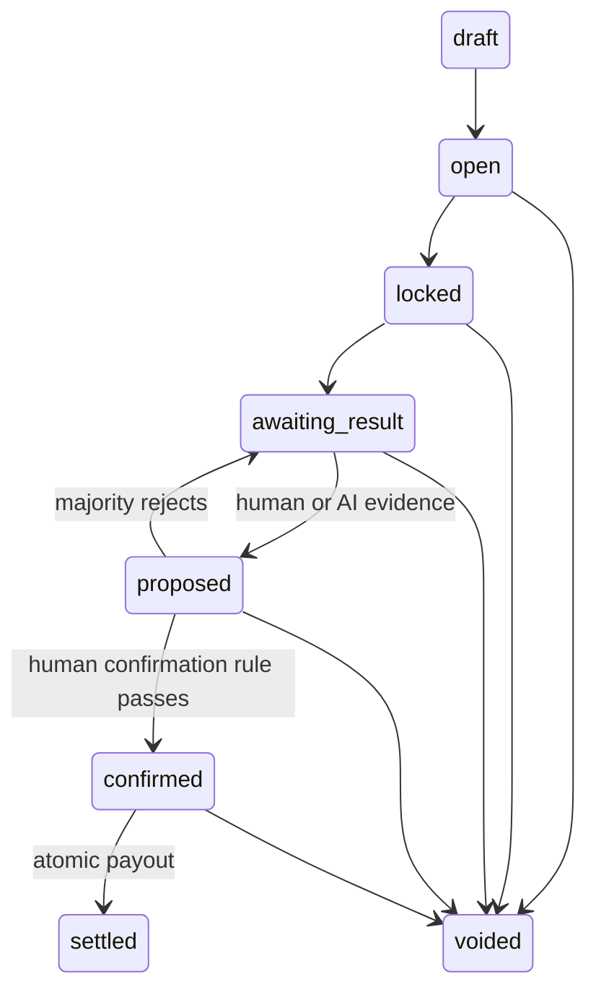

# Overcall architecture

## Trust boundaries

Next.js and Expo use the publishable Supabase key and a user session. RLS limits reads to group members, except deliberately public feed posts. Neither client may update a balance, entry, proposal, vote, or prop state directly. Authenticated clients call `prop_command(action, payload)`. A security-invoker public wrapper delegates to a private, guarded transaction function. `auth.uid()` is always required; client-supplied user IDs cannot impersonate the caller.

The vision Edge Function verifies its bearer token with `auth.getUser`, validates membership using the caller's RLS-scoped client, then claims a rate-limited analysis slot. The OpenRouter key and Supabase service-role key stay server-side. Only that service role can call `record_vision`. Even this function cannot confirm or settle: it may only log an extraction and move an awaiting prop to proposed.

## Prop lifecycle

Creation atomically opens the prop, snapshots expected members, debits the initiator, inserts their entry, and writes a ledger row. The draft state is available in the shared state model; saving persistent drafts is not exposed in the current UI/RPC.

Timer joins check the database clock, even before the host marks the prop locked. Manual and event locks require a creator/admin action. Event locks have no external event feed yet. There is no unlock transition. After a majority rejects, a new proposal gets a new ID; old votes cannot carry into it.

## Wallet correctness

- 1,000 tokens are granted on signup; a profile and grant ledger row are inserted by the auth trigger in the same transaction.
- Daily rewards add 50 tokens at most once per UTC database date.
- Group rows lock before prop rows. Settlement locks participant wallets in UUID order to avoid inconsistent wallet lock ordering across different groups.
- Entries are unique per `(prop_id, user_id)`. An insufficient-balance error rolls back the entry and every other write.
- Amounts are positive integers. Fixed entry requires the configured amount; match entry requires the initiator's stake. Free entry means no prescribed buy-in, with a chosen positive stake.
- Winners receive their stake plus their proportional share of losing stakes. Equivalently, payout is `floor(totalPool * winnerStake / totalWinningStake)`; leftover tokens go to winning entry IDs in ascending order, one each. The full pot is conserved with no platform fee.
- One-sided pools cannot settle and must be voided by the admin. Voids return 100% of every stake.
- Final props cannot settle or refund again. Partial unique ledger indexes are a second duplicate-payment guard.

## Human confirmation

The group setting is copied onto each new prop so an admin cannot change its confirmation rule after entries arrive. All votes are unique per proposal/user, and an eligible voter may change their vote before confirmation.

| Rule               | Requirement                                          |
| ------------------ | ---------------------------------------------------- |
| majority (default) | More than half of all participants approve           |
| initiator_plus_one | Initiator and at least one other participant approve |
| admin              | The group owner explicitly approves                  |

Unanimous agreement is not necessary. Majority means all participants, including those who have not voted. High AI confidence never counts as a vote. A confirmed result is frozen; an admin can still void before final settlement.

## Screenshare and vision

The browser requests a user-selected display via `getDisplayMedia`, previews it locally, and sends a downscaled JPEG frame every 20 seconds while the result dialog is open. The database rate gate allows at most one analysis per prop per 15 seconds. The browser stops tracks on close, on the display ending, on errors, and when the prop leaves awaiting-result state.

This implementation does **not** broadcast the stream to other users over WebRTC. `getDisplayMedia` is the capture side; a signaling channel, `RTCPeerConnection`, TURN credentials, and receiver flow are separate future work. Native scoreboard capture is also deferred. Frames go directly to the authenticated Edge Function; the evidence bucket is private and has no client upload policies. No screenshot bytes are persisted by the app. Provider retention depends on the chosen OpenRouter provider/account settings.

Vision returns player, over, sixes, wickets, runs, confidence, proposed side, evidence explanation, and a sufficient-evidence flag. Missing facts must be null. A cumulative score alone is not sufficient proof of events in one specific over. Screenshots and propositions are treated as untrusted data in the prompt. Runtime schema validation rejects malformed outputs. Each provider attempt is recorded before inference; validated extractions and sanitized failure states update that audit row. Interrupted requests can remain pending for operational review.

## Realtime and privacy

Postgres Changes subscriptions refresh UI after changes. Published tables are props, entries, votes, chat, the wallet ledger, and public feed posts. SELECT policies still apply. Member and group changes are refreshed after the admin action; they are not currently realtime-published. The feed stores public text only; it does not mirror private props. Follows are private to the follower. Room leaderboard ranks current member balances, not model-derived skill.

## What remains before a production launch

- Provision and test a real Supabase instance and OpenRouter model; run Supabase security/performance advisors.
- Test database concurrency against an actual multi-connection Postgres server, not just PGlite.
- Add production email delivery, abuse controls, observability, global/per-user inference budgets, pagination, pending-attempt recovery, and deployment integration tests.
- Add a licensed sports-score provider or authorized in-house ingestion, event-driven locks, and complete standard markets. The UI score is explicitly sample data. Pool shares are not bookmaker odds or guaranteed probabilities.
- Add WebRTC signaling/TURN, mobile screen capture, Expo device QA and release signing.
- Add opt-in global rankings, weekly/activity reward policies, richer social profiles/follow UX, group join links, moderation, and strict-mode enforcement beyond flags.

The repository is a tested MVP foundation, not a claim that these integrations are already live.
